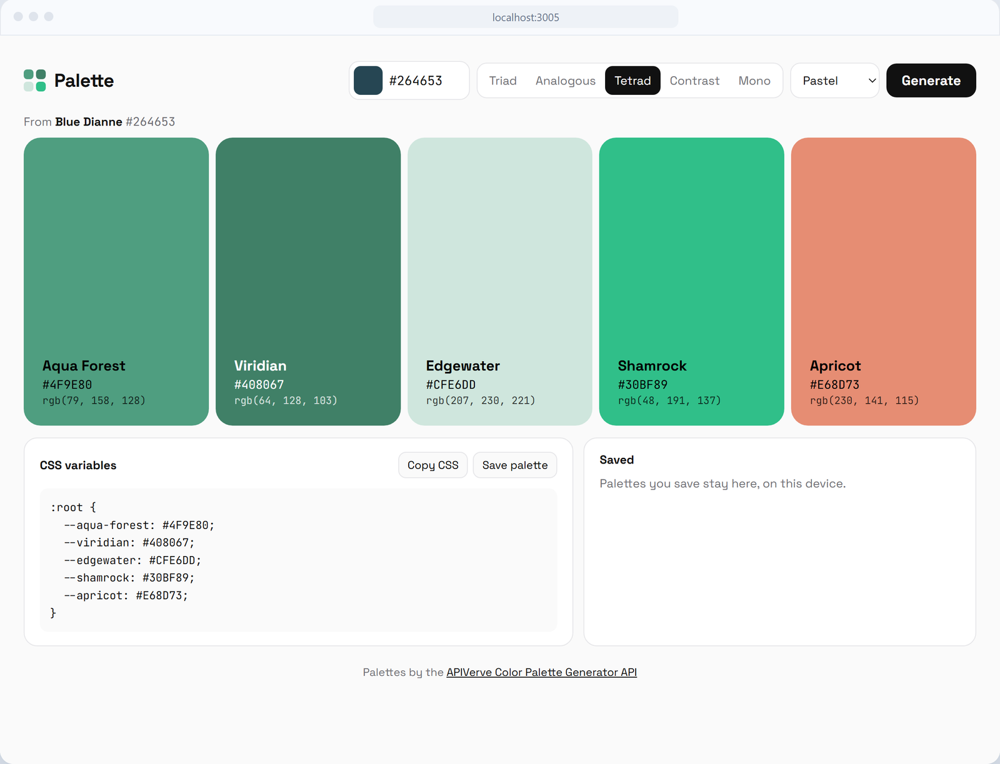

# Palette Generator | APIVerve Template

[](LICENSE)
[](package.json)
[](tsconfig.json)
[](https://apiverve.com/marketplace/colorpalette?utm_source=github&utm_medium=template&utm_campaign=palette-generator-nextjs-tutorial)

A color palette app you can deploy in one click. Pick one color, choose a harmony (triad, analogous, tetrad, contrast or mono) and a mood like pastel or soft, and get a named palette with hex and RGB codes. Click a swatch to copy it, copy the whole palette as CSS variables, and save palettes on your device. It works on desktops and phones from the same code.

[](https://vercel.com/new/clone?repository-url=https%3A%2F%2Fgithub.com%2Fapiverve%2Fpalette-generator-nextjs-tutorial&project-name=palette-generator&repository-name=palette-generator&env=APIVERVE_API_KEY&envDescription=Your%20APIVerve%20API%20key.%20Free%20to%20create%2C%20no%20card%20needed.&envLink=https%3A%2F%2Fdashboard.apiverve.com%2Fsignup%3Fapi%3Dcolorpalette%26utm_source%3Dvercel%26utm_medium%3Dtemplate%26utm_campaign%3Dpalette-generator-nextjs-tutorial)



---

### Get your free API key

This template needs an APIVerve API key. **[Sign up free](https://dashboard.apiverve.com/signup?api=colorpalette&utm_source=github&utm_medium=template&utm_campaign=palette-generator-nextjs-tutorial)**, no credit card required.

---

## Deploy in one click

Click **Deploy with Vercel** above. Vercel copies this repo to your GitHub account, asks for your `APIVERVE_API_KEY`, and gives you a live URL about a minute later.

## Run it locally

```bash
git clone https://github.com/apiverve/palette-generator-nextjs-tutorial.git
cd palette-generator-nextjs-tutorial
npm install
cp .env.example .env   # then set APIVERVE_API_KEY in .env
npm run dev
```

Open `http://localhost:3000`. To see it in a phone and a browser frame side by side, open `http://localhost:3000/showcase.html`.

## How it works

1. `components/PaletteApp.tsx` is the page: the color picker, scheme and mood controls, the swatches and the CSS panel. It calls `/api/palette?color=...&scheme=...&variation=...`.
2. `app/api/palette/route.ts` checks the input, then calls Color Palette Generator. Your API key stays on the server and never reaches the browser. Answers are cached for a day, and cached answers don't count against the rate limit.
3. Each swatch is drawn in its own color with the text color the API recommends for it, so labels stay readable. The CSS variables are named after each color, and saved palettes are kept in `localStorage`.

Everything here works on a free key: five colors with names, hex, RGB and a readable text color on every plan. Paid plans can ask for up to 16 colors and add HSL, contrast scores, ready-made CSS and a palette image.

```
app/
  api/palette/route.ts   the server route: validates, caches, calls the API
  layout.tsx             fonts and metadata
  page.tsx
  globals.css
components/
  PaletteApp.tsx         the app
lib/
  apiverve.ts            key, rate limit, cache and the API call
public/
  showcase.html          the phone and desktop demo frame
```

### The API call

```ts
const res = await fetch('https://api.apiverve.com/v1/colorpalette?color=264653&scheme=tetrade&variation=pastel', {
  headers: { 'x-api-key': process.env.APIVERVE_API_KEY! }
});
const { data } = await res.json();
```

## Before you share your URL

Once deployed, anyone who finds your URL can use it on your API key. Each visitor can make 10 uncached requests a minute, and repeat lookups come from the cache, which is fine for a demo. Both are kept in memory, so they aren't shared between serverless instances. For production:

- Put the page behind your own sign-in, or
- Move the limit and cache to a shared store such as [Upstash Redis](https://upstash.com/), or
- Call the route only from your own backend.

## Ideas to extend it

- Convert each color to HSL or CMYK with [Color Converter](https://apiverve.com/marketplace/colorconverter?utm_source=github&utm_medium=template&utm_campaign=palette-generator-nextjs-tutorial).
- Name any color a visitor types with [Color Name Finder](https://apiverve.com/marketplace/colornamefinder?utm_source=github&utm_medium=template&utm_campaign=palette-generator-nextjs-tutorial).
- Turn the palette into a shareable card with [HTML to Image](https://apiverve.com/marketplace/htmltoimage?utm_source=github&utm_medium=template&utm_campaign=palette-generator-nextjs-tutorial).

## API reference

- [Color Palette Generator](https://apiverve.com/marketplace/colorpalette?utm_source=github&utm_medium=template&utm_campaign=palette-generator-nextjs-tutorial): `GET https://api.apiverve.com/v1/colorpalette`
- [Full documentation](https://docs.apiverve.com?utm_source=github&utm_medium=template&utm_campaign=palette-generator-nextjs-tutorial)

## Tech stack

- **Next.js 16** (App Router) and **React 19**, in **TypeScript**
- A **Route Handler** in `app/api/` for the server side, so the key never reaches the browser
- Deploys to Vercel as-is, with no configuration

## License

MIT. See [LICENSE](LICENSE).
